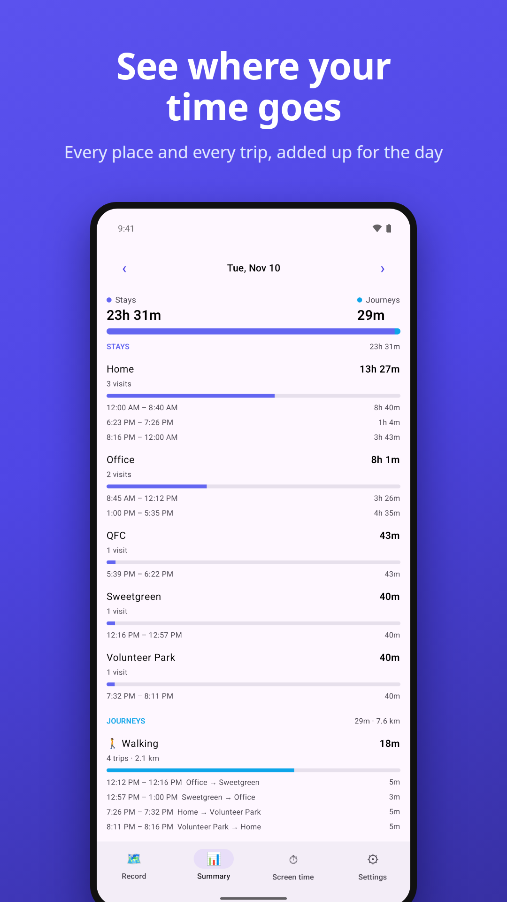

# Life Tracker


**Where does your time go? Where does your money go?**
Life Tracker is an Android app that quietly records your days — the places
you go, how you get there, what you spend, and how you use your phone — so
you can see your life clearly and change what you want to change.

[Download](https://github.com/mayueanyou/LifeTracker/releases/latest) ·
[Privacy policy](https://mayueanyou.github.io/LifeTracker/privacy.html) ·
[Tell me what you think](https://github.com/mayueanyou/LifeTracker/issues/new/choose)

<p align="center">
  
  
  
  
  
  
</p>

<sub>Screenshots show a made-up demo day, not a real person's places.</sub>

---

## Why I made it

Most of us don't really know where our hours and our money go. A week feels
busy, the bank balance feels lower than it should — but the details vanish.

Life Tracker keeps those details for you, without you typing anything. At
the end of a day, a week or a month you can look back and see it plainly:
the evenings spent at home, the times you went out, the money spent on
restaurants, the hours on your phone. Knowing that is the first step to
adjusting your life the way *you* want — maybe spending less on eating out,
maybe getting outside more to stay healthy, maybe just understanding
yourself a little better.

## Your data stays yours

- **On your phone, or in your own Google Drive — nowhere else.** Everything
  Life Tracker records is stored on your phone. If you choose to sign in
  with Google, it is also backed up to *your own* Google Drive, as plain
  files you can open and read yourself.
- **No account, no server, no ads, no tracking.** There is no Life Tracker
  server. Nothing you record is ever sent to me or to anyone else.
- **You decide.** Every permission is asked for one step at a time, with the
  reason. You can turn recording off, remove places, sign out of Google, or
  uninstall — uninstalling deletes everything on the phone.

## Security

- **Everything comes from your own phone.** Your position comes from your
  phone's location; your purchases from the notifications your bank already
  sends to your phone; your screen time from Android's own usage record.
  Life Tracker reads them on the phone and works everything out on the
  phone.
- **Only what it needs is kept.** From notifications, only the ones that read
  as money spent are stored — never your messages, chats or anything else.
- **The little that goes online is limited and listed.** Map tiles come from
  OpenStreetMap. To name the places you stay, the app can ask OpenStreetMap
  services what is at a spot — the coordinates only, with no name or account
  attached — and you can turn that off in Settings. Backups go straight from
  your phone to your Drive, and the app can see only the files it created
  there, nothing else in your Drive.
- **Open source.** Every line of the app is in this repository, so anyone can
  check exactly what it does. MIT licence.

## What it does

- **Your day as a map and a timeline.** Every place you stayed and every
  journey between them — driving, walking or cycling — worked out from your
  phone's positions and drawn on a map, with a calendar-style timeline below.
- **Where your time goes.** A summary of each day: hours at each place, every
  visit added up, and time spent driving, walking and cycling, with distances.
- **Where your money goes.** Card purchases read from your bank's
  notifications, each matched to the place you were when you paid. Day and
  month totals at the top, a cost on each event, and your own items for
  anything paid in cash.
- **Where your phone time goes.** Screen time per day and per app, and for
  every stay and journey, which apps you were using and when.
- **A month at a glance.** Tap the day's name for the month, with what each
  day cost.
- **Backup to your own Google Drive**, nightly, with restore — optional.

## Get the app

Life Tracker is in testing and not on the Play Store yet.

1. Download the latest `.apk` from
   [Releases](https://github.com/mayueanyou/LifeTracker/releases/latest) and
   open it on your Android phone (Android 8 or newer).
2. To get updates automatically, add this repository to
   [Obtainium](https://github.com/ImranR98/Obtainium):
   `https://github.com/mayueanyou/LifeTracker`.
3. Open the app and go through its six quick steps — your location,
   "Allow all the time", the recording notice, Battery **Unrestricted**,
   screen time, and your bank's notifications. Each is explained first, and
   each opens right where Android keeps that switch. Last, sign in with
   Google to back up to your own Drive — or skip it and keep everything on
   the phone.

## Tell me what you think

This app gets better from your feedback, and I read every issue.

- **Something not working?** [Report a problem](https://github.com/mayueanyou/LifeTracker/issues/new?template=bug.yml).
  Settings › *Share diagnostics* gives a short report with no locations in it
  that helps a lot.
- **An idea or a wish?** [Suggest something](https://github.com/mayueanyou/LifeTracker/issues/new?template=idea.yml).
- **Your bank's purchases not counted, or counted wrong?**
  [Tell me about your bank](https://github.com/mayueanyou/LifeTracker/issues/new?template=bank.yml) —
  with a masked example of its notification, so Life Tracker can learn to
  read it for everyone who banks there.
- **Anything else** — questions, thoughts, what you learned about your own
  days — [open an issue](https://github.com/mayueanyou/LifeTracker/issues/new/choose).
  Comments on existing issues are welcome too.

---

## How it works

**Stays and journeys** are worked out on the phone from its own recorded
positions: a stay is anchored where it began and re-centred once; a quiet
phone does not end a stay; imprecise positions and jumps are ignored; a slow
walk is a pause, not a stay; five minutes in one place is a stay; a journey
is cut into drive and walk by sustained vehicle speed — stop-and-go city
driving counts as one drive — and measured along its route. Each day is
rebuilt from scratch from its positions, so midnight is a clean cut.

**Places** are named by your own named places first, then OpenStreetMap: a
named building the spot is inside; otherwise the most likely named place
within 150 m (a shop or cafe before an office, never a car park); otherwise
the nearest address, "near 120 Main Street". Where you parked is named by the
street. A place the map cannot name is named after the shop you paid at.

**Money.** Each card charge goes to the stay you were at when it arrived
(15 minutes either side, closest wins), never guessed from the merchant's
name. Only a notification that reads as money spent counts — "payment
posted", balances, refunds, rewards, transfers, shipping and one-time codes
do not — in the main languages and every common way of writing an amount
("$1,234.56", "1.234,56 €", "R$ 89,90", "Rs. 500"). A known bank counts by
itself; any other app that sends a purchase — a wallet, Gmail showing the
bank's alert, the Messages app showing the bank's text — is asked about once.
The same purchase reported by several apps counts once, the bank's copy kept.
Any charge can be marked "Not a purchase" (that one, or every message shaped
like it), and amounts from your money apps that did not read as a purchase
wait a week in Settings › Money to be counted with a tap. Tap an event to add
your own items or mark it "No cost".

**Screen time** comes from Android's own usage record — the source Digital
Wellbeing uses — read with the *Usage access* permission you grant. Android
keeps the detail for about a week; Life Tracker saves each day and each app
session as it goes and never deletes them, so history lasts.

**Backup.** Each night, days that changed are written to
*My Drive › Life Tracker › 2026-11 › 2026-11-17.json* as plain JSON — the
day's positions, stays and journeys, purchases, typed costs and screen time —
plus your named places. Only the `drive.file` permission is asked for.
Restore adds what the phone lacks and never replaces anything.

## Permissions

| Permission | Why |
|---|---|
| Location, including "Allow all the time" | Record where you are while the app is closed. Asked for in steps, the way Android requires. |
| Foreground service (location), notifications | The ongoing "Recording your day" notice that background location needs. |
| Notification access | Read card purchases from your bank's notifications. Only notifications that read as money are kept, on the phone. |
| Usage access (`PACKAGE_USAGE_STATS`) | Read which app was on screen, and when. Granted by you in Settings. |
| Run at startup | Resume recording after the phone restarts, if it was on. |
| Internet | Map tiles, place names (can be turned off), and your Drive backup if you sign in. |
| Wake lock, network state | Added by Android's WorkManager library, for the background jobs. |

The app deliberately does **not** request `QUERY_ALL_PACKAGES`; app names and
icons come from the apps that appear in your launcher.

## Building

Requirements: JDK 17 and the Android SDK (platform 35).

```sh
echo "sdk.dir=/path/to/Android/sdk" > local.properties
./gradlew assembleDebug
# app/build/outputs/apk/debug/app-debug.apk
./gradlew testDebugUnitTest
```

`ReplayTest` replays a file of positions through the engine and writes the
stays and journeys it found, so they can be compared with another
implementation of the same rules. The file is never part of the repository;
the test skips itself without one:

```sh
LR_FIXTURE=/path/fixes.json LR_OUT=/path/out.txt ./gradlew testDebugUnitTest --tests '*ReplayTest*'
```

See [ROADMAP.md](ROADMAP.md) for where it is going.

## Licence

[MIT](LICENSE) — free to use, change and share.
